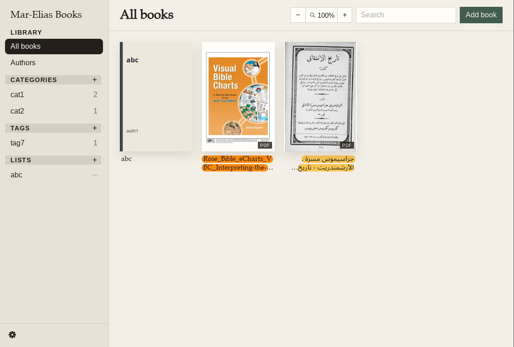
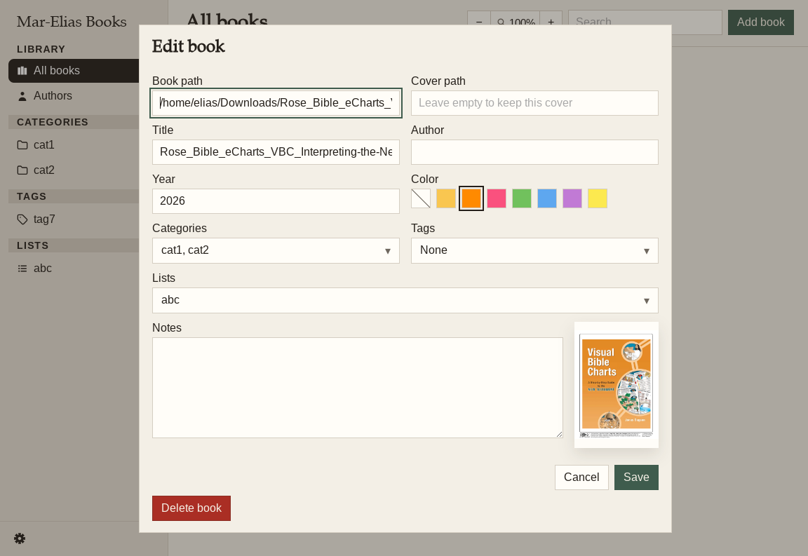

# Mar-Elias Books
A Linux app for organizing PDF and EPUB files.

Choose a database folder and a cover thumbnail folder. Book files stay where they are.

The window is a Tauri shell. The shelf itself is HTML. The code is rust/JavaScript.





## Build
Install WebKitGTK 4.1, GTK 3, Poppler, and Cairo, then run the app:

```bash
sudo apt install libwebkit2gtk-4.1-dev libgtk-3-dev libayatana-appindicator3-dev librsvg2-dev patchelf libssl-dev libpoppler-glib-dev libcairo2-dev libpango1.0-dev pkg-config build-essential

cargo install tauri-cli --version "^2"

cargo tauri dev
```

Rust 1.92 or newer is required. Okular is used to open books; if it is not installed, the file opens with `xdg-open`.

# Storage:
Library database: `/home/elias/.local/share/ebook-reader/library.db`

The zoom step is saved in the web view’s localStorage file: `/home/elias/.local/share/com.local.books/` WebKit creates the file the first time the desktop app uses localStorage. It is not there yet. Inside it, the row key is books-zoom, and the value is the step index 0–6 (2 is 100%).

#Similar apps:
1. https://github.com/everydaythingssoftware/citadel
2. Apple Books

# Done:
implement an app for linux desktop to organize pdf and epub books

I want to be able to add a new book to the database: Has title, author, year, categories, tags, front cover and a link to a local file. If the front cover isn't given, it should be extracted from the first page of the pdf/epub.

The books should be displayed in a grid, just like Apple Books.

On the left side is a side panel that has options: Library section containing "All books" and "Authors". And a "Lists" section, where I can create new lists and drag and drop books from the library.

Double clicking a book should open the book using Okular (or a different app).

A small icon to the bottom right of a book cover should show if it's a pdf or an epub.

Use Tauri + HTML/CSS

***

The add book dialog should not open a window to browse files

Instead: It should ask for 2 paths: One for the book; and another for the cover.

If the cover path isn't supplied, it is gotten from the first page.

It is possible to add a book entry without a book path or a cover path.

***

The side panel should have 2 more sections: One is "Categories" another is "Tags" each one to browse all existing categories and tags across all books.
